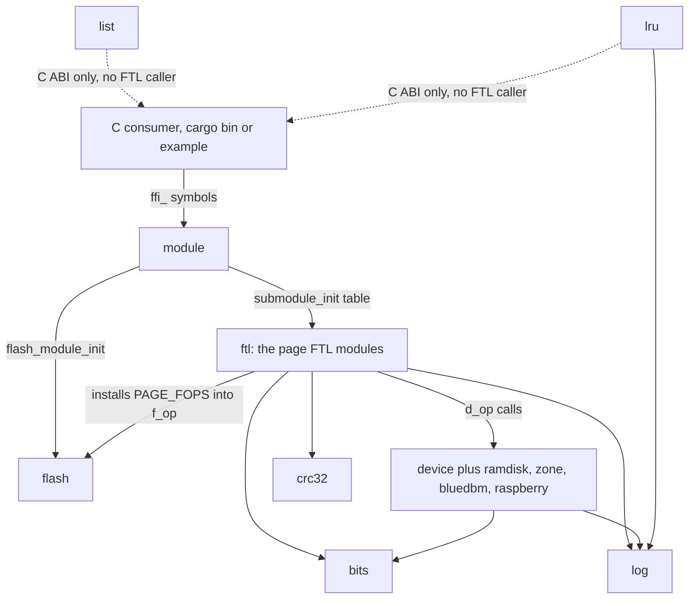
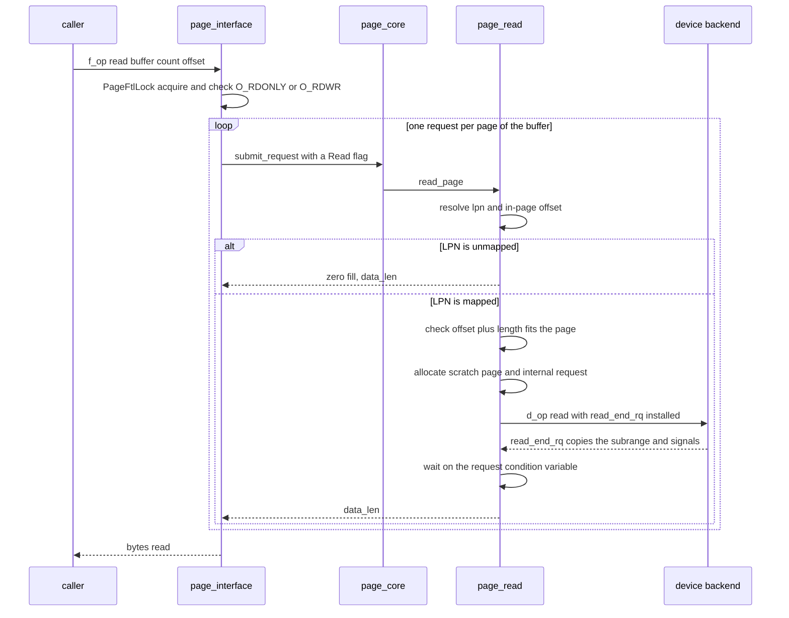
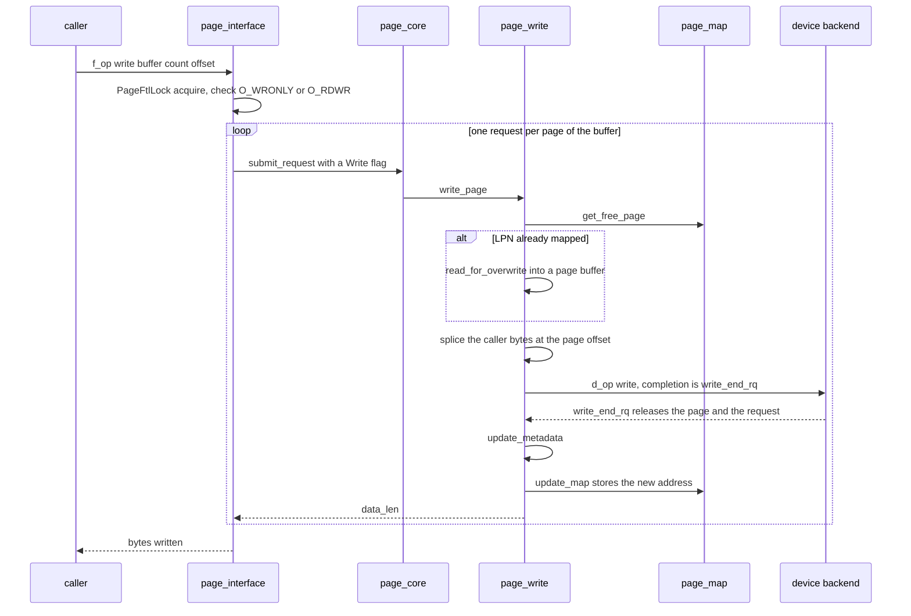
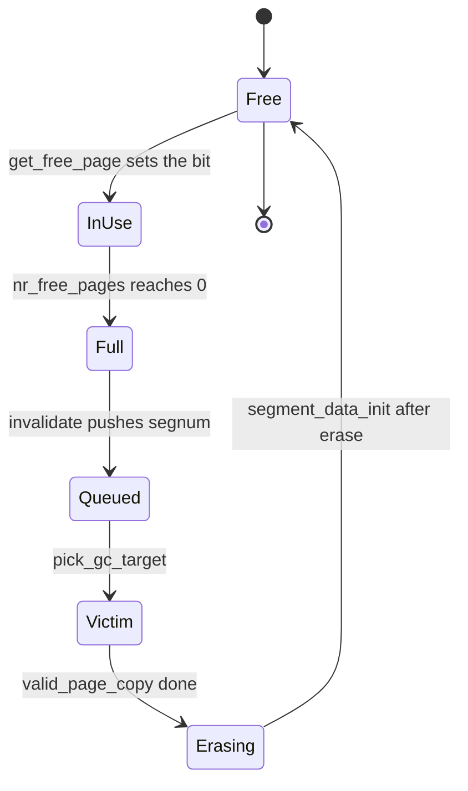

# Architecture

This is the internal shape of the library, not its user guide. Every claim
below comes from a file in the repository, cited as `path:line`, and the
source wins wherever an older comment disagrees with it.

## 1. What the library is

The library is a page-mapping flash translation layer over a block device. A
caller hands it a byte offset and a length. The FTL splits that into page
sized pieces, translates each piece's logical page number (LPN) to a physical
page address through a page-level L2P table, and drives the backend one NAND
operation at a time.

Three things follow from that, and they explain most of the code:

- **The mapping table is the whole state.** `PageFtl::trans_map` holds one
  `u32` physical address per logical page (`src/ftl/mod.rs:452`), plus one
  terminator slot, because `map_size` adds one entry before it converts bytes
  to slots (`:505`, `:507`). `PADDR_EMPTY` means "not mapped"
  (`src/device/mod.rs:82`).
- **A NAND page is programmed once between erases.** An overwrite therefore
  reads the page the LPN currently maps to, splices the new bytes into a copy,
  writes that copy to a free page, and invalidates the old mapping
  (`src/ftl/page_write.rs:89`, `:205`, `:59`). The old page stays on the
  device until its segment is erased.
- **Space is reclaimed by segment.** A segment is one block across every bus
  and chip, so `nr_segments` is the block count and `pages_per_segment` is
  `nr_bus * nr_chips * pages_per_block` (`src/device/mod.rs:407`, `:412`,
  `:417`). When a segment has no free page left, it joins the collection
  queue and a background thread copies its live pages elsewhere and erases
  it (`src/ftl/page_gc.rs:246`).

Two layers plus helpers implement this. The device layer owns the backend
vtable and the geometry. The FTL layer owns the mapping, the allocator, the
collector and the C-facing bridge. `bits` and `log` are the helpers both
layers call, `crc32` serves the checkpoint, `list` and `lru` are exported for
C alone, and the `ffi_` functions are the C ABI boundary.

## 2. Module map

- `module` is the entry point. `ffi_module_init` allocates the flash handle,
  then dispatches through `SUBMODULE_INIT`, whose only entry is
  `page_interface::ffi_page_ftl_module_init` (`src/module.rs:50`, `:120`).
- `flash` is a three-field handle: the installed vtable, the submodule's
  private data and its teardown (`src/flash.rs:44`). It does no I/O itself.
- `ftl` holds the state and all the policy. `page_core` owns the lifecycle,
  the checkpoint and the request dispatch (`src/ftl/page_core.rs:224`).
  `page_read` and `page_write` are the two data paths, `page_gc` the
  collector, `page_map` the allocator and the single-entry map write
  (`src/ftl/page_map.rs:36`, `:104`), and `page_interface` the bridge that
  installs `PAGE_FOPS` and splits caller buffers into page requests
  (`src/ftl/page_interface.rs:320`).
- `device` owns the `#[repr(C)]` mirrors, the backend vtable, the request
  allocation pair and the geometry accessors (`src/device/mod.rs:396`,
  `:442`). The backend table is `SUBMODULE_INIT` there too, with the ramdisk
  wired in and the other three behind their cargo features
  (`src/device/mod.rs:625`).
- `bits` supplies the bitmap primitives the allocator and the GC queue use
  (`src/ftl/page_map.rs:22`, `src/ftl/page_gc.rs:33`).
- `crc32` is used only by the checkpoint (`src/ftl/page_core.rs:37`).
- `log` backs the `pr_*!` macros every module calls.
- `list` and `lru` are exported for C consumers and are not called from any
  FTL path. Nothing under `src/ftl/` names either module.

The call order for a fresh handle is `ffi_module_init`, then
`ffi_flash_module_init`, then `ffi_page_ftl_module_init`, which installs
`PAGE_FOPS` into `flash->f_op`, allocates the `PageFtl`, and brings up the
device module the flag word names (`src/ftl/page_interface.rs:340`). The
first `open` reaches the FTL through the installed table.

## 3. The read path

The interface holds one lock for the whole transfer and allocates one request
per page, so a transfer that does not start or end on a page boundary submits
a partial first and last request (`src/ftl/page_interface.rs:125`, `:227`).
Each iteration calls `submit_request`, which switches on the request flag and
calls `read_page` (`src/ftl/page_core.rs:224`).

`read_page` resolves the LPN and the in-page offset, refuses an LPN at or past
the table with `EINVAL` (`src/ftl/page_read.rs:111`), and zero fills an
unmapped page (`:119`). A mapped page is read whole into a scratch `Vec`, with
`read_end_rq` installed as the completion callback (`:139`, `:164`). The
backend's `read` is called directly through `d_op` (`:169`). The callback
copies the requested subrange out, releases the scratch page and the internal
request, and signals the caller's condition variable (`:57`). The read path
then waits on that condition variable (`:184`), which on the ramdisk is
already signalled because the backend completes inline.

Failure shape: a missing handle or a null request is `EINVAL`, a failed
request allocation is `ENOMEM`, and a device failure is the backend's negated
errno. A short read is not treated specially here, the caller's loop advances
by what was returned (`src/ftl/page_interface.rs:247`).

## 4. The write path

`write_page` checks the LPN bound and the in-page bound, then asks
`get_free_page` for a page (`src/ftl/page_write.rs:184`). The allocator starts
at `alloc_segnum`, walks every segment once, skips bad segments and segments
with no free page, takes the first zero bit of the chosen segment's
`use_bits`, sets it, decrements `nr_free_pages`, increments `nr_valid_pages`
and advances the cursor (`src/ftl/page_map.rs:36`).

For an already mapped LPN, `read_for_overwrite` reads the page from the start
of the page holding the LPN, not from the caller's offset
(`src/ftl/page_write.rs:89`). The new bytes are spliced in, and the whole page
is handed to the backend with `write_end_rq` as the completion callback
(`:207`, `:225`). A backend that fails does not run the completion callback,
so on that path the write path releases the page and the request itself
(`:232`).

`update_metadata` invalidates the previous mapping, appends the LPN to the new
segment's `lpn_list` and calls `update_map` (`src/ftl/page_write.rs:118`).
Invalidation clears the `trans_map` entry and decrements `nr_valid_pages`,
but deliberately leaves `nr_free_pages` alone: an invalidated page is still
programmed until the erase (`:59`, `:69`). When the segment has no free page
left and is not already queued, invalidation puts it at the head of `gc_list`
and sets its bit in `gc_seg_bits` (`:74`).

The write path reports `EINVAL` for either bound, `EFAULT` for no free page
and for a failed read-for-overwrite, `ENOMEM` for a failed request
allocation, and the backend's negated errno for a failed write. A backend
that reports a non-negative short write is turned into `EIO`
(`src/ftl/page_write.rs:232`, `:238`).

## 5. The GC path

Two things trigger collection:

- The collector thread wakes once a second (`src/ftl/page_core.rs:53`) and
  runs `gc_pass`, which skips the pass while the free-page fraction is above
  20 per cent and otherwise collects up to 10 per cent of the segments
  (`src/ftl/page_core.rs:244`, `src/ftl/mod.rs:370`, `:377`).
- The `PAGE_FTL_IOCTL_TRIM` ioctl collects the whole queue, because it passes
  `PAGE_FTL_GC_ALL` as the ratio (`src/ftl/page_interface.rs:288`, `:312`).

Both end in `gc_from_list`, which loops `submit_request` with an erase flag.
The dispatch turns that flag into `do_gc` (`src/ftl/page_gc.rs:288`,
`src/ftl/page_core.rs:228`). The loop stops when the queue is empty or when
the ratio bound is reached.

`pick_gc_target` sorts the queue by `nr_valid_pages` ascending, takes the
head, unlinks it, and pins the victim's `nr_free_pages` to 0 so the copy
cannot allocate back into the segment it is draining
(`src/ftl/page_gc.rs:62`). `valid_page_copy` repeatedly takes the tail of the
victim's `lpn_list`, reads that page whole and rewrites it through the write
path (`:214`). The write path's invalidation unlinks the LPN from the victim,
which is what advances the walk. `segment_erase` then sends one erase request
to the backend (`:93`), and `segment_data_init` resets the free count, the
valid count, the bitmap and the list before `gc_seg_bits` is cleared
(`src/ftl/page_core.rs:151`, `src/ftl/page_gc.rs:265`).

The checkpoint fits at the lifecycle boundary, not in the pass. `close` joins
the collector and then writes `<device name>.ckpt`: magic, version,
`alloc_segnum`, the device geometry, the entry count, a CRC32 over header and
body, the whole L2P table, and one free page count per segment
(`src/ftl/page_core.rs:330`, `:755`). `open` loads it back before spawning the
collector and rebuilds each segment's `use_bits` from the free counts, not
from the mapping, so an invalidated but still programmed page is not handed
out twice (`:415`, `:551`). A file that fails any check is ignored and the
mapping starts empty. A collector that panicked makes the join fail, and
`close` deletes the checkpoint instead of writing one (`:776`).

One consequence worth naming: when `do_gc` fails after `pick_gc_target`, the
segment has already left `gc_list` and its `gc_seg_bits` bit is still set, so
invalidation will not queue it again (`src/ftl/page_gc.rs:255`, `:262`). The
segment stays stranded until the next `open`.

## 6. Data structures and the lock

Every field lives in `PageFtl` or `PageFtlSegment`, both in
`src/ftl/mod.rs`. The line numbers below are that file's.

| Structure | Line | Holds | Guarded by |
| --- | --- | --- | --- |
| `trans_map` | 452 | one `u32` PADDR per LPN | `PageFtlLock` |
| `alloc_segnum` | 453 | round-robin cursor | `PageFtlLock` |
| `segments` | 454 | one segment per block | `PageFtlLock` |
| `mutex` | 458 | the FTL lock itself | n/a |
| `gc_thread` | 462 | collector handle | n/a |
| `gc_list` | 464 | queued segments, head first | `PageFtlLock` |
| `gc_seg_bits` | 465 | segments already queued | `PageFtlLock` |
| `checkpoint` | 471 | path `close` writes to | open and close only |
| `nr_free_pages` | 399 | free pages in a segment | `AtomicI32` |
| `nr_valid_pages` | 400 | live pages in a segment | `AtomicI32` |
| `use_bits` | 401 | programmed pages | `PageFtlLock` |
| `lpn_list` | 402 | LPNs, oldest first | `PageFtlLock` |

`open` builds and restores these before the collector exists, and `close`
tears them down after the join, so the checkpoint restore and teardown paths
run without the lock (`src/ftl/mod.rs:570`).

Two details that the comments make easy to get wrong:

- `lpn_list`'s **last** element is the list head, the most recently written
  page, and that is the end the GC walk reads (`src/ftl/mod.rs:389`,
  `src/ftl/page_gc.rs:215`).
- `nr_free_pages` is not decremented on invalidation, only on allocation, and
  it is reset by the erase. That is why the checkpoint can rebuild `use_bits`
  from it: programmed pages are the prefix below the free count
  (`src/ftl/page_core.rs:551`).

## 7. Concurrency model

There is exactly one FTL lock. `PageFtl::mutex` is a `Mutex<()>`, and
`PageFtlLock` takes it and returns the exclusive `&mut PageFtl` borrow behind
it (`src/ftl/mod.rs:458`, `:578`, `:589`). The borrow alone would not exclude
a second caller, because both callers reach the same structure through a raw
pointer, so the mutex is what makes the borrow exclusive.

Nine sites acquire it, and each holds it for a whole operation:

- the three flash hooks `page_ftl_write_interface`, `page_ftl_read_interface`
  and `page_ftl_ioctl_interface` (`src/ftl/page_interface.rs:107`, `:211`,
  `:295`), each for the entire multi-page transfer
- the `ffi_` entry points of read, write and GC (`src/ftl/page_read.rs:213`,
  `src/ftl/page_write.rs:267`, `src/ftl/page_gc.rs:324`, `:349`)
- the dispatch entry point `ffi_page_ftl_submit_request`
  (`src/ftl/page_core.rs:815`)
- one turn of the collector thread, taken around the whole pass
  (`src/ftl/page_core.rs:315`)

`page_core::open` and `page_core::close` hold nothing: they establish and end
the lifecycle the lock belongs to, and `open` runs the segment and checkpoint
setup before the collector exists (`src/ftl/mod.rs:570`).

A poisoned lock is recovered, not propagated. `lock_recover` logs and takes
the guarded state back, because a collector panic must not turn into a panic
in every later caller (`src/ftl/mod.rs:550`). The mapping a panicked pass may
have torn is handled by `close` deleting the checkpoint, as above.

Where atomics and pthread primitives actually appear:

- `nr_free_pages` and `nr_valid_pages` are `AtomicI32`, read and updated with
  `SeqCst` by the allocator, invalidation, the GC victim pick and the
  checkpoint restore (`src/ftl/page_map.rs:90`, `src/ftl/page_gc.rs:70`).
- The collector's stop request is a process-wide `static
  Mutex<Option<HashSet<usize>>>` keyed by FTL address, so one FTL's close
  stops only its own thread (`src/ftl/page_core.rs:63`).
- `device_request` embeds a `pthread_mutex_t` and a `pthread_cond_t` around
  `is_finish` (`src/device/mod.rs:304`). The read path is the only place that
  locks them: the completion callback signals and the reader waits
  (`src/ftl/page_read.rs:85`, `:184`).
- `struct device` also embeds a `pthread_mutex_t` (`src/device/mod.rs:397`).
  It is initialized and destroyed (`:807`, `:768`) but no code in this tree
  locks it.
- The raspberry backend serializes its libnand calls with its own
  `Mutex<()>`, one guard per call (`src/device/raspberry.rs:250`, `:317`).

There is no read/write lock and no per-bus lock. Both were removed from the C
original and nothing replaced them (`src/ftl/mod.rs:22`).

## 8. Build shape

One crate, two library artefacts from the same sources: `staticlib` produces
`libftl_rust.a`, which C links, and `rlib` produces what `tests/` links
(`Cargo.toml:10`). The archive is the only library `make install` puts down,
next to the headers from `include/` (`Makefile:82`, `:133`).

Three cargo targets sit beside the library:

| Target | Kind | Path |
| --- | --- | --- |
| `rw_example` | example | `example/rw_example.rs` |
| `integration-test` | bin | `integration-test.rs` |
| `benchmark` | bin | `benchmark.rs` |

Five features gate optional code, and each maps to a `Makefile` switch:

| Feature | Effect | Switch |
| --- | --- | --- |
| `silent` | `pr_*!` are no-ops | `USE_LOG_SILENT=1` |
| `legacy-random` | legacy benchmark seed | `USE_LEGACY_RANDOM=1` |
| `zone` | zoned backend, 3/3/5/21 bits | `USE_ZONE_DEVICE=1` |
| `bluedbm` | bluedbm backend | `USE_BLUEDBM_DEVICE=1` |
| `raspberry` | raspberry backend | `USE_RASPBERRY_DEVICE=1` |

The geometry each feature selects is generated from `ftl.yaml` into
`src/ftl_config.rs` and `include/ftl-config.h` (`make config`, gated by
`make check-config`).

The `zone` feature changes the address bit split, not just the backend table
entry (`src/ftl_config.rs`), so a zoned build decodes a `device_address`
differently from the default build. The C headers in `include/` are the ABI
contract for consumers: 46 `ffi_`-prefixed entry points across the crate, plus
the pre-existing `crc32` (`src/crc32.rs:68`), for 47 `#[no_mangle]` symbols
in total.
