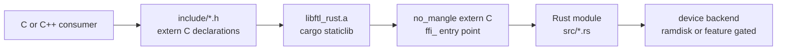

# The C ABI

Every implementation in this tree is Rust. The archive the build produces is
`libftl_rust.a` (`Cargo.toml:10`, `Makefile:82`), and the only C left is the
thirteen headers under `include/`, which declare the symbols that archive
exports. This document explains what that boundary is, which parts of it a
consumer sees, and how the tree proves it still works.

## Why the headers still say `extern "C"`

The headers are the contract a C or C++ consumer compiles against, and a
header cannot say what language the implementation is written in. `extern "C"`
in a header is a property of the declaration, not of any definition, so it
survives the migration unchanged.

For C it is a no-op. For C++ it is what stops the compiler from mangling the
declaration, which is the only reason it is there. The proof is mechanical. A
translation unit that declares and calls `ffi_module_init` through
`include/module.h` compiles to an undefined symbol with the plain name:

```text
$ g++ -std=c++17 -Iinclude -c probe.cpp -o probe.o
$ nm -g probe.o | grep ffi_module_init
                 U _ffi_module_init
```

A C++ function defined in the same file, with no `extern "C"` around it, comes
out mangled (`__Z5probev` in the Mach-O object for `void probe(void)`), so
the wrapper is doing the work. Without it, a C++ consumer would emit a
mangled call and the link against the archive would fail to find
`ffi_module_init`.

The Rust side answers with both halves of the C convention. `src/module.rs`
defines the same symbol:

```rust
// src/module.rs:119
#[no_mangle]
pub unsafe extern "C" fn ffi_module_init(
    modnum: c_int,
    flash: *mut *mut flash_device,
    flags: u64,
) -> c_int {
```

`#[no_mangle]` keeps the symbol name, `extern "C"` selects the C calling
convention. The header declares it exactly that way:

```c
/* include/module.h:28 */
int ffi_module_init(const int modnum, struct flash_device **, uint64_t flags);
```

Both sides of that one symbol are pinned by the pair above. The same pattern
repeats for every declared entry point, and `include/module.h:23-27`,
`include/flash.h:106-113` and `include/device.h:321-330` each carry a comment
recording which C source used to hold the implementation and when it went.

## The `ffi_` naming rule

Every symbol the archive exports carries the `ffi_` prefix (`AGENTS.md:75`).
There are 47 `#[no_mangle]` functions in `src/`, 46 of them prefixed. The
prefix marks the C ABI surface, so it is greppable as one pattern and cannot
collide with a Rust-native name in the same module. A header and the module
behind it then name the same thing, which is what makes the pairing above
readable.

There is one documented exception. `crc32` predates the migration and keeps
its plain name:

```rust
// src/crc32.rs:67
#[no_mangle]
pub extern "C" fn crc32(buf: *const c_void, size: usize, initial: u32) -> u32 {
```

It is declared the same way in `include/crc32.h:29`. Renaming it would break
every existing consumer for no gain, so the exception is recorded in
`AGENTS.md:75` rather than quietly patched.

Nothing forces the two sets to be equal, and they are not. The headers also
declare six symbols the default archive does not carry, because the zoned,
bluedbm and raspberry backends compile only behind their cargo features. The
count is:

- 47 `#[no_mangle]` functions in `src/`
- 39 of them exported by a default `cargo build --release` archive
- 34 distinct symbols declared across the thirteen headers
- 11 exported symbols with no declaration, the Rust-facing entry points such
  as `ffi_flash_read` and `ffi_page_ftl_read`

The mismatch is deliberate. A header declares what a C consumer calls. A
Rust-only caller, the benchmark or the integration test, links the same
crate and reaches the extra `#[no_mangle]` symbols directly, and a header
declaration for those would be a promise to a consumer that does not exist.

## The types the ABI passes

A struct both sides read by offset stays `#[repr(C)]` and has its offsets
asserted on both sides, so a drift fails a build instead of corrupting memory
at runtime (`AGENTS.md:77-80`). The mirrors are:

| Type | Header | Rust |
| --- | --- | --- |
| `device` | `include/device.h:186` | `src/device/mod.rs:395` |
| `device_request` | `include/device.h:132` | `src/device/mod.rs:303` |
| `device_address` | `include/device.h:103` | `src/device/mod.rs:204` |
| `device_page` | `include/device.h:154` | `src/device/mod.rs:360` |
| `device_block` | `include/device.h:161` | `src/device/mod.rs:367` |
| `device_package` | `include/device.h:169` | `src/device/mod.rs:375` |
| `device_info` | `include/device.h:177` | `src/device/mod.rs:383` |
| `device_operations` | `include/device.h:198` | `src/device/mod.rs:441` |
| `DeviceModule` | `include/device.h:48` | `src/device/mod.rs:134` |
| `DeviceDirection` | `include/device.h:39` | `src/device/mod.rs:162` |
| `flash_device` | `include/flash.h:38` | `src/flash.rs:43` |
| `flash_operations` | `include/flash.h:52` | `src/flash.rs:63` |
| `list_node_t` | `include/list.h:18` | `src/list.rs:29` |
| `lru_node` | `include/lru.h:33` | `src/lru.rs:55` |
| `lru_cache` | `include/lru.h:43` | `src/lru.rs:72` |

The layout assertions are the `DEVICE_STATIC_ASSERT` block
(`include/device.h:224-315`), the `FLASH_STATIC_ASSERT` block
(`include/flash.h:78-102`), `LIST_STATIC_ASSERT` (`include/list.h:40-47`) and
`LRU_STATIC_ASSERT` (`include/lru.h:67-91`). Their Rust halves are the
`layout_matches_c` tests in `src/device/mod.rs:953`, `src/flash.rs:173`,
`src/lru.rs:355` and `src/list.rs:208`, which assert the same formulas with
`offset_of!` and `size_of!`.

Third party types are mirrored the same way where the backend reads their
fields. `src/device/zone.rs:148,168` mirrors `struct zbd_info` and
`struct zbd_zone` and pins their sizes with `const _: () = assert!(...)` at
`src/device/zone.rs:185-186`. `src/device/bluedbm.rs:130,150` mirrors
`bluedbm_dma_t` and `async_bdbm_req`, with `memio_t` at
`src/device/bluedbm.rs:121` kept as an opaque zero-sized type because only a
pointer to it ever crosses.

Other types are deliberately opaque. `PageFtl` and `PageFtlSegment`
(`src/ftl/mod.rs:398,451`) are plain Rust types with no `repr` at all: C
reaches the FTL through `flash_operations` and `flash->f_private`, never by
offset, which `include/page.h:22-35` records. The same holds for the backend
state in `ZoneBackend`, `Raspberry`, `Ramdisk` and `Bluedbm`, and for the
Rust-only tail of `lru_cache` (`src/lru.rs:72-86`). That last one has a
consequence a consumer can trip over: `sizeof(struct lru_cache)` in C is
smaller than the Rust value, so the header forbids sizing it by hand
(`include/lru.h:56-59`) and only `ffi_lru_init` allocates one.

## Ownership and lifetime

The rule is that the pair which allocates is the pair which frees, and both
halves are declared next to each other.

- The module handle comes from `ffi_module_init` and goes back to
  `ffi_module_exit` (`include/module.h:28-29`). Exit runs the submodule
  teardown, then releases the flash handle, so a consumer calls exactly one
  free for the one init.
- A flash handle is created by `ffi_flash_module_init` and released by
  `ffi_flash_module_exit` (`include/flash.h:114-115`, `src/flash.rs:118,145`).
  The page FTL installs its own teardown into `f_submodule_exit`, so a
  consumer never calls the pair directly while a submodule is live.
- A device request is allocated by `ffi_device_alloc_request` and released by
  `ffi_device_free_request` (`include/device.h:335-336`,
  `src/device/mod.rs:663,697`). The read and write paths free the caller's
  request on the success path, exactly as C did
  (`src/ftl/page_read.rs:214-217`, `src/ftl/page_write.rs:266-271`), so a
  consumer frees it again only after an error return. Rust callers use the
  `Request` wrapper instead (`src/device/mod.rs:713`), whose `Drop` calls the
  free.
- A list is released by `ffi_list_free` (`include/list.h:60`). The node's
  `data` pointer is the caller's, and the module never reads or frees it
  (`src/list.rs:24-26,100`).
- An LRU cache is created by `ffi_lru_init` and released by `ffi_lru_free`
  (`include/lru.h:100,104`).

The device module pair `ffi_device_module_init` / `ffi_device_module_exit`
(`include/device.h:338-340`, `src/device/mod.rs:835,848`) is internal to that
contract. The page FTL calls it inside `ffi_page_ftl_module_init`, and
`ffi_page_ftl_module_exit` tears it down through the flash handle
(`src/ftl/page_interface.rs:352,401`), so a consumer that uses the module pair
never touches it.

## The call boundary



Read left to right: the consumer compiles the installed headers, links the one
archive, and calls the unmangled entry point, which is a Rust function that
dispatches to the module behind it.

## How the ABI is proven

`make consumer-check` is the gate (`Makefile:244-287`). It writes a small C
consumer to a temporary file, installs the archive and the headers into a
staging prefix under `$(PREFIX)`, compiles the consumer with
`-Wall -Wextra -Werror`, links it with `-lftl_rust -lm -lpthread`, and runs
it. The consumer calls `ffi_module_init` with `PAGE_FTL_MODULE` and
`RAMDISK_MODULE`, opens the flash, writes a value, reads it back, compares,
closes and calls `ffi_module_exit`.

That is why it is the real proof. Every claim this document makes is checked
by it: the headers compile as C, the `extern "C"` wrappers and the
`#ifndef` guards hold, the layout assertions pass against the compiler's own
offsets, the symbol names match the declarations, the archive links, and the
ramdisk round trip returns the value written. Nothing is added to the
repository, and a header that stops compiling fails the target.

CI runs it as its own step, `make clean && make consumer-check`
(`.github/workflows/build.yml:50-51`). It is also the only C compilation in
the tree, which is why `gcc` is the only compiler a Linux build needs
(`.github/workflows/build.yml:17-19`).

The C++ half of the wrapper is not exercised by any target, because no C++
source lives here and the build deliberately needs no `g++`
(`AGENTS.md:74`). It is checked by hand: a translation unit including all
thirteen headers compiles clean under
`g++ -std=c++17 -Wall -Wextra -Werror`. `docs/guards.md` records the same
check.
