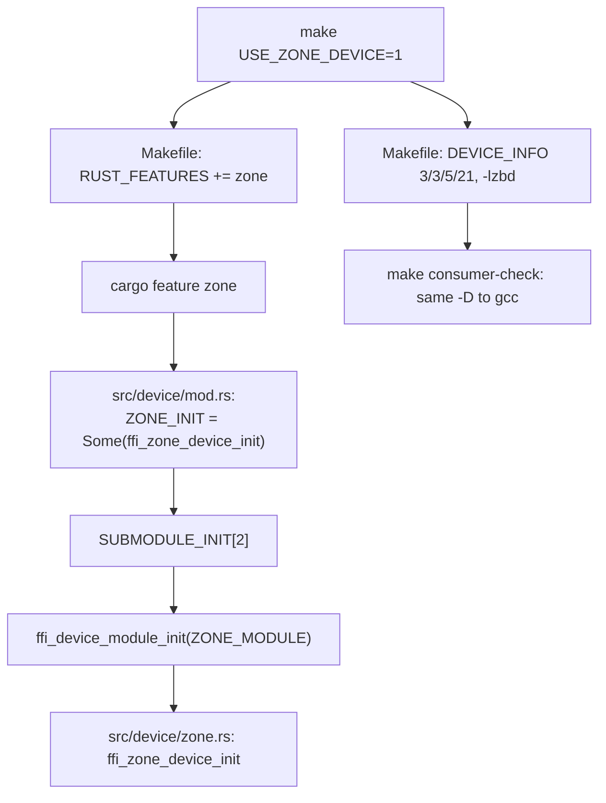

# Guards

Every check in the tree that stops a mistake from becoming a failure at
runtime. Each entry says what it protects, what breaks without it, and how it
is verified. Verification names a `make` target or a CI step, so a reader can
re-run it.

## Header guards

Each of the thirteen headers wraps its declarations in `#ifndef FOO_H`. The
guard keeps a second include in the same translation unit from redefining a
struct or a prototype.

| Guard | Header | Compiled by |
| --- | --- | --- |
| `DEVICE_H` | `include/device.h:8` | `make consumer-check` |
| `FLASH_H` | `include/flash.h:8` | `make consumer-check` |
| `LOG_H` | `include/log.h:8` | `make consumer-check` |
| `MODULE_H` | `include/module.h:8` | `make consumer-check` |
| `PAGE_H` | `include/page.h:8` | `make consumer-check` |
| `BITS_H` | `include/bits.h:8` | `make check` |
| `BLUEDBM_H` | `include/bluedbm.h:8` | `make check` |
| `CRC32_H` | `include/crc32.h:8` | `make check` |
| `LIST_H` | `include/list.h:8` | `make check` |
| `LRU_H` | `include/lru.h:10` | `make check` |
| `RAMDISK_H` | `include/ramdisk.h:8` | `make check` |
| `RASPBERRY_H` | `include/raspberry.h:7` | `make check` |
| `ZONE_H` | `include/zone.h:8` | `make check` |

`make consumer-check` compiles the five headers the consumer includes
(`Makefile:253-257`), which is a real include with gcc at `-Werror`. The other
eight are read by cppcheck, flawfinder and lizard through `make check`
(`Makefile:222-228`) but no compilation includes them, so a guard there is
currently checked by parsing only.

`include/device.h` also guards the geometry overridable at compile time:
`DEVICE_PAGE_SIZE` (`:25`), `DEVICE_NR_BUS_BITS` (`:63`),
`DEVICE_NR_CHIPS_BITS` (`:67`), `DEVICE_NR_PAGES_BITS` (`:71`) and
`DEVICE_NR_BLOCKS_BITS` (`:75`). Each `#ifndef` supplies the default, so a
consumer that passes `-DDEVICE_NR_*_BITS` on the command line gets its own
value. `make consumer-check` is what passes those flags
(`Makefile:283`), and without the guards the compiler would warn about the
redefinition under `-Werror`.

## C++ wrappers

`extern "C"` around the public declarations, guarded by `#ifdef __cplusplus`,
is what lets a C++ consumer link the archive. Without it the C++ compiler
mangles the declarations and the link fails. The wrappers are in all thirteen
headers, for example `include/module.h:11-13`. The `static_assert` macros
choose the C++ or the C spelling behind the same guard
(`include/flash.h:71-76`, `include/device.h:215-222`, `include/list.h:34-38`,
`include/lru.h:61-65`).

No target in the tree compiles C++, so this guard has no automated check.
Checked by hand on this tree:

```text
$ g++ -std=c++17 -Wall -Wextra -Werror -Iinclude -c all.cpp -o all.o
$ echo $?
0
```

with `all.cpp` including all thirteen headers. It compiles, which exercises
the C++ half of every wrapper and every `static_assert` macro, and a probe
that calls `ffi_module_init` leaves `U _ffi_module_init` in the object file,
the unmangled name the archive exports.

## Layout assertions

A struct both sides read by offset is pinned by `_Static_assert` in the header
and by a `layout_matches_c` test in Rust, so a drift fails a build rather than
corrupting memory. The list file names its test `node_layout_matches_c`.

| Assertions | Header | Rust test |
| --- | --- | --- |
| `DEVICE_STATIC_ASSERT` | `include/device.h:224` | `src/device/mod.rs:953` |
| `FLASH_STATIC_ASSERT` | `include/flash.h:78` | `src/flash.rs:173` |
| `LIST_STATIC_ASSERT` | `include/list.h:40` | `src/list.rs:208` |
| `LRU_STATIC_ASSERT` | `include/lru.h:67` | `src/lru.rs:355` |
| zbd sizes | `src/device/zone.rs:185` | `cargo test --features zone` |

The zbd sizes are pinned by `const _: () = assert!(...)` rather than by a
named test, which is why that row names the build instead.

Verified by `make test` for the Rust half and `make consumer-check` for the C
half, which compiles the assertions against the consumer compiler's own
offsets.

## Cargo features

Five features gate whole backends or behaviours. A feature that is off
compiles its module out entirely, so the default build links no library it
does not need.

| Feature | Protects | Verified by |
| --- | --- | --- |
| `silent` | `pr_*` macros are no-ops | `make test USE_LOG_SILENT=1` |
| `legacy-random` | benchmark seed source | `make benchmark.out` |
| `bluedbm` | libmemio backend | `cargo build --features bluedbm` |
| `raspberry` | libnand backend | `cargo test --features raspberry` |
| `zone` | libzbd backend | `make zone-smoke`, `cargo test --features zone` |

The features are declared at `Cargo.toml:36` (`silent`), `:41`
(`legacy-random`), `:47` (`bluedbm`), `:48` (`raspberry`) and `:49`
(`zone`). The `silent` feature is the Rust side of `-DENABLE_LOG_SILENT` and
swaps `pr_info!`, `pr_warn!` and `pr_err!` for no-ops (`src/log.rs:50-87`),
which CI builds with `make clean && make test USE_LOG_SILENT=1`
(`.github/workflows/build.yml:58-59`). `legacy-random` drops the `getentropy`
seed (`benchmark.rs:555`). The three backend features are what select a
backend module into the tree: `#[cfg(feature = "zone")] mod zone;` and the
matching entry in the device table (`src/device/mod.rs:597-629`).

## Makefile switches

The switches are the documented interface, and each device switch also names
the library the backend binds and the geometry its header must be compiled
with.

| Switch | Selects | Effect |
| --- | --- | --- |
| `USE_ZONE_DEVICE=1` | `zone` | `-lzbd`, geometry `3/3/5/21` |
| `USE_BLUEDBM_DEVICE=1` | `bluedbm` | `-lmemio`, geometry `3/3/7/19` |
| `USE_RASPBERRY_DEVICE=1` | `raspberry` | `-lnand -lwiringPi` |
| `USE_LOG_SILENT=1` | `silent` | no-op log macros |
| `USE_LEGACY_RANDOM=1` | `legacy-random` | legacy benchmark seed |
| `USE_DEBUG=1` | none | debug cargo profile |

The switch table is `Makefile:12-19`, the geometry and library each one sets
is `Makefile:37-79`, and the feature mapping is `Makefile:97-115`. The
raspberry switch also sets the `1/1/4/24` bit counts and a 2048 byte page
(`Makefile:67-71`). The geometry macros matter beyond the Rust build:
`make consumer-check` passes the same `DEVICE_INFO` to the C consumer
(`Makefile:283`), so a consumer of a zoned archive decodes
`struct device_address` the way the archive does.
Without that, the two sides would disagree about where the block field starts.
The Rust constants behind the same geometry are `#[cfg]`-selected in
`src/device/mod.rs:96-117` for `zone`, while bluedbm and raspberry keep their
own counts beside their backends (`src/device/bluedbm.rs:100-102`,
`src/device/raspberry.rs:104-116`).

## CI jobs

Two jobs run on every pull request, and Codacy runs a third check.

| Job | Uniquely catches |
| --- | --- |
| `build-and-test-x86_64` | header analysis, the C consumer, clippy |
| `zone-emulator` | the libzbd build and the zoned paths against a real device |
| Codacy | markdownlint over the documentation |

`build-and-test-x86_64` (`.github/workflows/build.yml:10-63`) runs `make
check` (cppcheck, flawfinder and lizard over the headers,
`Makefile:222-228`), `make flow` (cflow, `Makefile:233-234`), builds the
archive and the two programs, runs the integration test and the benchmark
twice, runs `make consumer-check`, runs the Rust suite with the `silent`
feature, runs clippy as `-D warnings` and builds `--features silent`. It is
the only job that compiles C and the only one that runs the consumer.

`zone-emulator` (`.github/workflows/build.yml:70-127`) installs `libzbd-dev`,
builds and lints with `--features zone`, creates an emulated zoned device
through `null_blk`, falling back to `zloop`, and runs `make zone-smoke` plus
`cargo test --features zone`. It also measures coverage of those paths. It
catches what the first job cannot: a break in the libzbd binding or in the
zoned request path, neither of which can run without the library and a zoned
device.

Codacy runs markdownlint, which is the gate for any line this document
touches. Where the other two jobs are declared in the workflow, Codacy is
configured outside the tree.

## `cfg(test)` seams

A seam is a production type that a test replaces. Each one exists because the
real dependency cannot run on every machine.

| Seam | Where | Stands in for |
| --- | --- | --- |
| `module_init_with(table, ...)` | `src/module.rs:61` | the submodule table |
| `module_init_with(table, ...)` | `src/device/mod.rs:781` | the backend table |
| `NandApi` | `src/device/raspberry.rs:191` | the libnand entry points |
| `Fixture` | `src/ftl/test_support.rs:39` | a small ramdisk geometry |

The dispatch functions take their table as a parameter, so the shipped table
and a mock table run the same code. That is how
`init_rejects_an_out_of_range_module_number` (`src/module.rs:246`) and
`module_init_error_paths` (`src/device/mod.rs:1219`) drive the error paths,
an out-of-range `modnum` and a failing submodule init, without a device.
`NandApi` is a struct of function pointers filled from the real symbols in
`NandApi::system` and from fakes in `fake_api`
(`src/device/raspberry.rs:202,700`), which is what lets the raspberry backend
have tests at all on a machine without libnand.
`Fixture` wraps a real ramdisk backend narrowed to a four-segment geometry.

These compile only with `cargo test`, and the `#[cfg(test)]` attribute is what
keeps a fake out of the release archive. Verified by `make test` and, for the
backend features, the matching job or `cargo test --features <name>`.

## Compiler gates

Three gates treat warnings as errors. `cargo clippy --all-targets -- -D
warnings` is the Rust policy now that no C source is compiled
(`Makefile:303-304`). `make consumer-check` compiles the consumer with
`-Wall -Wextra -Werror` (`Makefile:283`), which is what keeps a header line
clean. `make check` runs cppcheck, flawfinder and lizard over the headers
(`Makefile:222-228`), and `make flow` runs cflow over the inline helpers
(`Makefile:233-234`). CI runs all four.

## Backend selection

One representative flow: how a build picks a device backend from a `USE_*`
switch and lands in the device table.



The ramdisk entry is always wired (`src/device/mod.rs:626`). Each other slot
is `None` until its feature turns it `Some` (`src/device/mod.rs:604-617`), so
a build without the feature reports `-ENODEV` from the dispatch instead of
calling a backend that is not there. `src/device/mod.rs:96-117` selects the
same `zone` geometry in Rust that `Makefile:39-42` passes to the C consumer.
